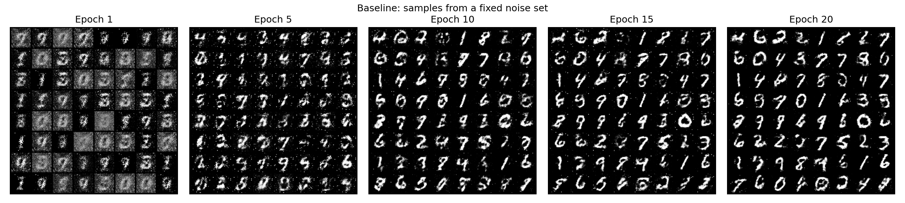
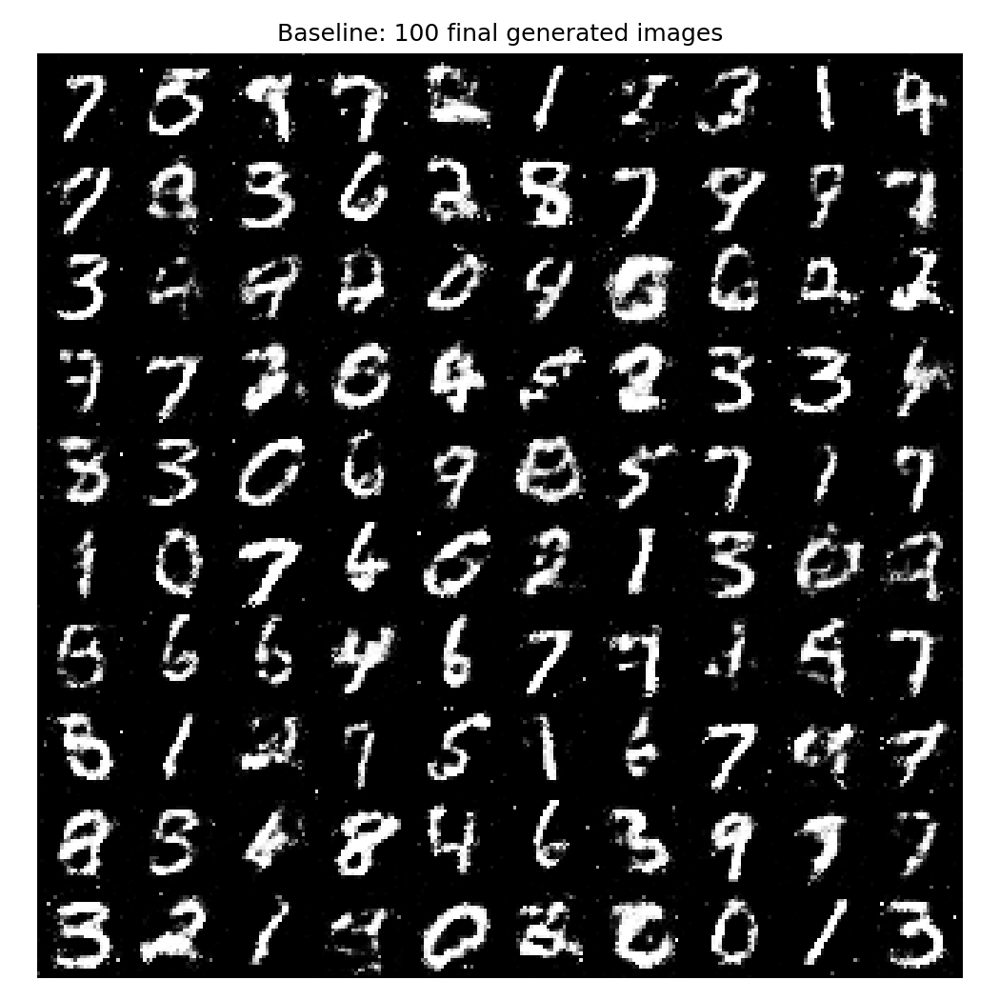
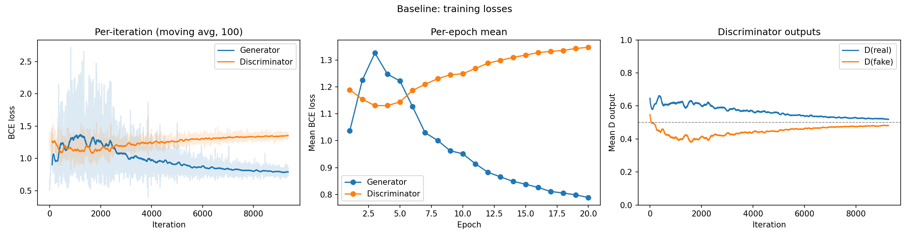
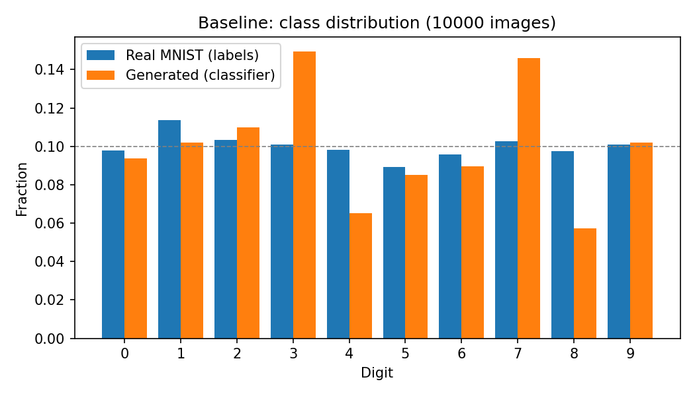
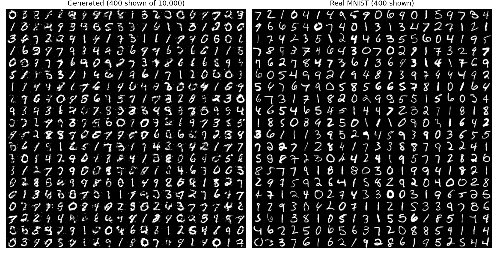
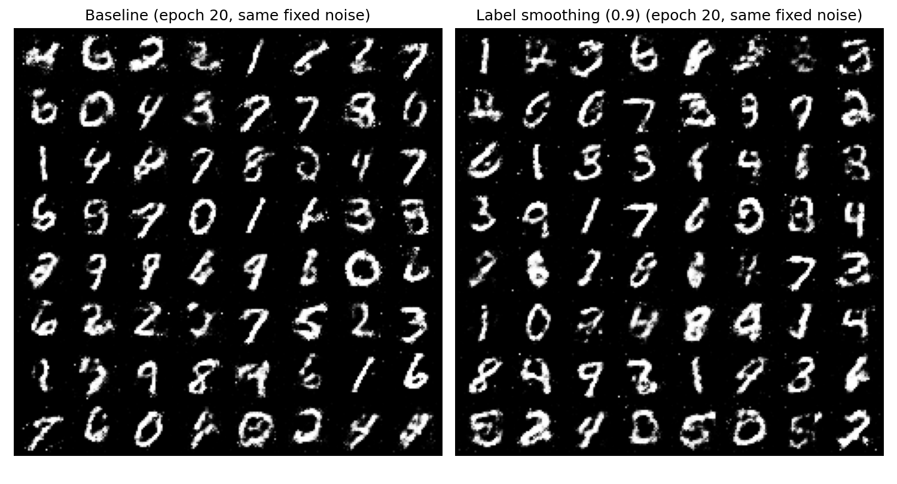
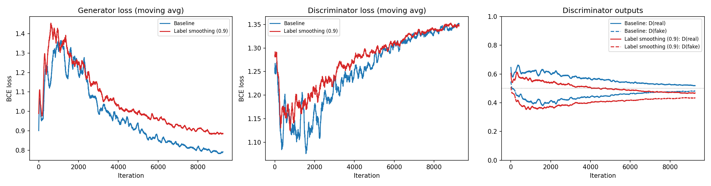
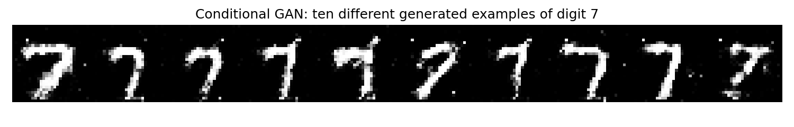
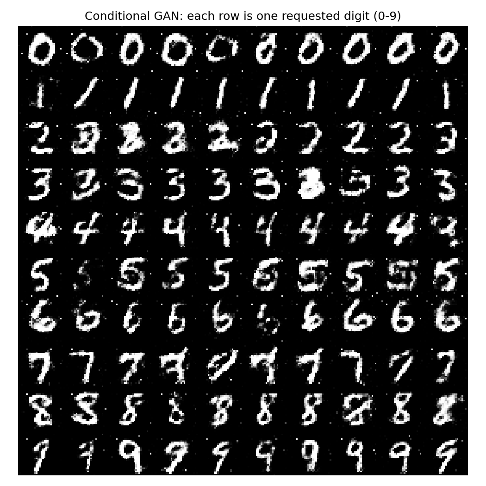

# Generative Adversarial Network on MNIST — Report

All numbers below come from `python run_all.py` (seed 42, CPU). Figures are in `results/` and `samples/`.

## 1. Introduction to GANs

A Generative Adversarial Network (Goodfellow et al., 2014) trains two networks against each other. The **generator** G
maps random noise z to a synthetic sample; the **discriminator** D receives a sample and outputs the probability that it
is real. D is trained to separate real from generated data, while G is trained to fool D. At the ideal equilibrium G's
output distribution matches the data distribution and D outputs 0.5 everywhere. Here the data are 28×28 MNIST digits.

## 2. Generator and discriminator

| | Generator | Discriminator |
|---|---|---|
| Input | 100-d noise z ~ N(0, I) | 1×28×28 image in [-1, 1] |
| Layers | Linear 100→256→512→1024→784, each hidden layer followed by **BatchNorm1d + ReLU** | Flatten, Linear 784→512→256→1, **LeakyReLU(0.2)** + **Dropout(0.3)** after each hidden layer |
| Output | **Tanh**, reshaped to 1×28×28 | **Sigmoid** probability of "real" |

(`gan/models.py`.) Data are normalised to [-1, 1] with `Normalize((0.5,), (0.5,))` to match the Tanh output.

**Deviations from the recommended architecture.** My first version used exactly the specified layers (plain Linear + ReLU
in G, no dropout in D). It mode-collapsed: every fixed-noise sample was the same image from epoch 1, and at epoch 20 the
discriminator loss crashed to 0.06 with generator loss 7.1 and a fully collapsed output. Adding BatchNorm to the
generator's hidden layers and Dropout(0.3) to the discriminator fixed this, so these two changes are part of the baseline.
I did not ablate them separately, so I cannot say which of the two mattered more.

## 3. Training procedure and hyperparameters

Binary cross-entropy loss, Adam for both networks. Per batch (`gan/train.py`):

1. D step on real images (target 1) and on `G(z).detach()` (target 0); D loss = sum of the two BCE terms.
2. G step: `D(G(z))` against target 1 (the non-saturating generator loss).
3. Record G loss, D loss and mean D(real) / D(fake) every iteration; save samples from a fixed noise set after every epoch.

| Hyperparameter | Value |
|---|---|
| Learning rate | 0.0002 (both) |
| Adam betas | (0.5, 0.999) |
| Batch size | 128 (last partial batch dropped) |
| Epochs | 20 (9,360 iterations) |
| Latent dim | 100 |
| Seed | 42 |

I kept the suggested values: they are the standard DCGAN-style settings, and they trained stably once the architecture
issue above was fixed. Training takes about 20 s/epoch on CPU.

## 4. Generated samples across training

All panels use the same 64 noise vectors. Epoch 1 gives blurry, noisy blobs with grey backgrounds; by epoch 5 digit
shapes appear; by epochs 10–15 strokes are crisp and most samples are recognisable; epoch 20 is slightly cleaner again.
Individual noise vectors keep a loosely consistent identity from epoch 10 onward (e.g. the 1 in row 1, column 5).

## 5. Evaluation

### 5A. Qualitative

* **Recognisable:** most images are legible digits with MNIST-like stroke width and centring.
* **Most successful digits:** 0, 1 and 7 (simple, high-contrast shapes), plus many 3s.
* **Weaker digits:** 4, 5, 8 and 9 are more often broken, merged or ambiguous (e.g. 4/9 and 3/5/8 confusions).
* **Missing / repeated:** all ten digits appear, but 7 and 3 are repeated more often than 4 and 8 (see 5C).
* **Artifacts:** isolated speckle noise in the black background, stroke breaks, and some blobby filled-in 0/8 shapes.
  An MLP generator has no spatial inductive bias, which likely contributes to ragged strokes.

### 5B. Loss curves

* The first ~3 epochs are the least stable: G loss rises from 1.04 to 1.33 while D is winning, then falls as G catches up.
* After that both curves move smoothly and monotonically: epoch-mean G loss falls 1.33 → 0.79 and D loss rises
  1.13 → 1.35 (the BCE of a coin flip on real+fake is 2·ln 2 ≈ 1.386).
* In the last 500 iterations the mean D(real) is 0.52 and D(fake) is 0.48, i.e. D is close to chance.

This shows **no divergence, oscillation or collapse**, so training is stable, and it approaches the theoretical
equilibrium. Two caveats: (i) the drift toward D loss ≈ 1.35 partly reflects D dropout limiting how well D can separate
the classes, and (ii) GAN losses are not accuracy — the generator loss *decreased* over the last 15 epochs while the
samples improved only modestly. Loss alone
cannot tell us sample quality, so I rely on the images and the metrics below.

### 5C. Diversity analysis (10,000 generated images)

Quantitative tools (`gan/evaluate.py`): a small CNN trained on MNIST (98.8% test accuracy) used only as an evaluator;
class distribution of generated images is **approximate** because it relies on this classifier's predictions.

| Digit | 0 | 1 | 2 | 3 | 4 | 5 | 6 | 7 | 8 | 9 |
|---|---|---|---|---|---|---|---|---|---|---|
| Real MNIST | .098 | .114 | .103 | .101 | .098 | .089 | .096 | .103 | .097 | .101 |
| Generated | .094 | .102 | .110 | **.149** | **.065** | .085 | .089 | **.146** | **.057** | .102 |

* The model is diverse — every class is produced and class entropy is 3.26 bits vs 3.32 for real data — but not balanced:
  3 and 7 are over-produced (~15% each), 4 and 8 under-produced (~6%). Total-variation distance to the real distribution
  is 0.10. This is partial mode dropping, not full mode collapse.
* **Quality:** the classifier is ≥0.9 confident on only ~70% of generated images vs ~97% of real test images (mean
  confidence 0.895 vs 0.988), consistent with the ambiguous digits seen in 5A. The Frechet distance between classifier
  features of generated and real images is ≈ 115 (a FID-style number computed with this CNN, not the standard
  Inception FID, so it is not comparable to published values).
* **Repeated patterns / memorisation:** the mean nearest-neighbour distance within 1,000 generated images (5.28) is close
  to that within 1,000 real images (5.45), so generated samples are nearly as spread out as real ones. Generated images are
  farther from their nearest training image (5.28) than real test images are (4.54), so the generator is not copying
  training digits. The closest pairs are thin 1s, which are trivially similar.

Side by side, generated images show the right variety of slants and widths, but are noisier and less smooth than real digits.

## 6. Additional experiment: label smoothing

* **Change:** real-image target 0.9 instead of 1.0 in the D loss (one-sided label smoothing). Nothing else changed: same
  seed, architecture, hyperparameters and 20 epochs.
* **Reason:** the discriminator can become over-confident, which gives the generator saturated or uninformative
  gradients and is a common cause of instability. Smoothing is a cheap way to soften D.
* **Comparison with baseline** (`results/comparison/`):

| Metric | Baseline | Label smoothing (0.9) |
|---|---|---|
| Frechet distance (lower is better) | 114.9 | 108.5 |
| Class-distribution TV distance (lower is better) | 0.099 | 0.094 |
| Class entropy, bits (real 3.319) | 3.264 | 3.279 |
| Mean classifier confidence (real 0.988) | 0.895 | 0.895 |
| Fraction with confidence < 0.9 (real 0.033) | 0.301 | 0.297 |
| Mean NN distance within generated set | 5.28 | 5.32 |
| Final-epoch G / D loss | 0.789 / 1.347 | 0.886 / 1.347 |

* **Examples:** both models use the same fixed noise; the label-smoothed images are of similar overall quality, with a
  slightly different set of digits per noise vector.
* **Loss behaviour:** the smoothed model has a higher G loss throughout and a slightly lower D(real) (≈0.47 at the end vs
  0.52), as expected because real targets are 0.9. D loss ends at the same value.
* **Conclusion:** label smoothing gave a small, **inconclusive** change. The metrics differ slightly in its favour in this
  run, but my own earlier run of the same pipeline (same trained GANs, but a differently-initialised evaluation CNN) gave
  Frechet distances of 116.0 vs 125.6, i.e. the opposite ordering. The difference is therefore within evaluator noise, and
  with a single seed per model I cannot claim an improvement. The baseline was already stable (D(real)≈0.52), so there was
  little over-confidence for smoothing to fix.

## 7. Bonus: Conditional GAN

`gan/cgan.py`: a label embedding (10-d) is concatenated with the noise in G and with the flattened image in D; trained
with the same hyperparameters and 20 epochs. Ten different generated 7s:

The evaluator CNN agrees with the requested digit for **92.3%** of 5,000 generated images (per digit: 0 99%, 1 98%,
2 87%, 3 98%, 4 90%, 5 94%, 6 91%, 7 96%, 8 79%, 9 91%), and the 7s differ in slant and stroke. My first attempt used a
50-d label embedding and collapsed to a single image per digit (the generator ignored z, std across noise ≈ 0.009);
shrinking the embedding to 10-d fixed it.

## 8. Limitations and possible improvements

* Fully connected networks; a convolutional (DCGAN) generator and discriminator would likely remove the stroke
  fragmentation and background speckle.
* Under-produced digits (4, 8) indicate partial mode dropping; minibatch discrimination, spectral normalisation, or a
  Wasserstein/gradient-penalty loss could help.
* Evaluation uses a self-trained MNIST CNN rather than a standard metric, and approximate class counts inherit its errors.
* Single seed per configuration; conclusions on label smoothing would need several seeds. CPU runs reproduce the
  training losses exactly but evaluation metrics shifted slightly between runs (retrained evaluator).
* The BatchNorm/dropout additions were not ablated individually.

## 9. Conclusion

A fully connected GAN trained for 20 epochs on MNIST generates mostly recognisable digits with stable training, a
discriminator near chance, and reasonable but imperfect diversity (all classes present; 3 and 7 over-represented). The
architecture needed BatchNorm and discriminator dropout to avoid mode collapse. Label smoothing had no clear effect, and a
conditional variant can generate requested digits with ~92% label agreement.

## Code provenance

All code was written for this assignment from the standard GAN formulation; no tutorial code was copied. Library usage
(PyTorch, torchvision) follows their documentation. The Frechet distance formula follows the FID definition (Heusel et al.,
2017) applied to this project's CNN features.
